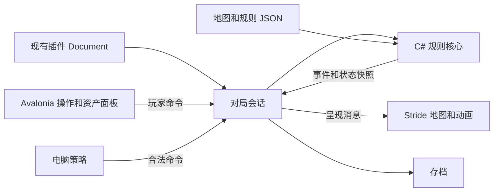

# 《大富翁4》式游戏 + Stride：可行性评估

调研日期：2026-09-15。

用户已确认目标为《大富翁4》式的城市路线、买地盖房、卡片道具玩法。本文是立项研究和建议，不代表已经实现或验证 Stride 在本项目中运行。已检查本地代码、在线一手资料、官方说明书部分相关页面，以及三个素材 ZIP 的格式与许可；未安装 Stride、编译游戏或进行性能实测。

## 1. 结论

**可行，建议采用 Windows x64、Stride 4.3、固定斜俯视角的低多边形 3D 城市、原创路线地图、本地人机对局。**

Stride 能承载这类小型回合制 3D 场景。主要工作量在规则状态、卡片组合、电脑策略、资源管线和 Avalonia Dock 集成。建议首先验证真实 Host 内的渲染、输入、窗口重建和关闭，再实施完整首版。

| 评估项 | 判断 | 成立条件 |
| --- | --- | --- |
| C# / .NET 技术匹配 | 好 | 本项目与 Stride 4.3 都使用 .NET 10 |
| 城市棋盘渲染 | 可行性高 | 控制模型、阴影、特效数量；性能用目标机器实测 |
| 玩法实现 | 可行，中等工作量 | 首版明确裁剪，避免全部系统同时开发 |
| 原创地图与基础美术 | 可行性高 | 使用 CC0 模块组合；补做地图规则和原创 UI |
| 嵌入现有插件 | 可行但必须验证 | 适配 HWND、Dock、输入、线程和内容路径 |
| 原版全部内容与表现复刻 | 大型工作 | 地图、角色、台词、美术、音效和规则组合均需投入 |

以上为工程判断，不是成功概率或交付保证。

## 2. 本地项目事实

已读取的依据：

- [插件构建基座](../../Directory.Build.props)：`net10.0`、C# 14。
- [插件依赖版本](../../Directory.Packages.props)：Avalonia Desktop 12.1.0，Plugin SDK / UI SDK 3.4.0，Build 1.1.3。
- [真实插件项目](../../src/ClassicGamePlugin.Plugin/ClassicGamePlugin.Plugin.csproj)：交付目标 `win-x64`，现有引用中没有 Stride。
- [模块注册](../../src/ClassicGamePlugin.Plugin/Plugin/ClassicGamePluginModule.cs)：当前已有 14 个独立游戏 Document，可按既有方式增加入口。
- [魔方 Document](../../src/ClassicGamePlugin.Plugin/Features/RubiksCube/RubiksCubeDocument.cs)：每个 Document 独立持有 ViewModel，关闭时释放会话资源，可借鉴生命周期边界；这不等于已有 Stride 集成。
- [插件开发说明](../README.md)：Standalone 只适合预览，Dock、加载上下文和生命周期需在真实 Host 验收；当前产品通过重启更新插件。

主仓还已具备独立程序集和原生库解析机制，`PluginLoadContext` 明确使用 `isCollectible: false`。因此首版不用承担“热卸载整个 Stride 引擎”的目标，但仍须在游戏页关闭时释放渲染设备、线程、窗口和音频资源。该加载上下文也不隔离原生崩溃。

同工作区的视频插件已有 `EmbeddedVideoSurface` 适配器，区分表面创建、丢失和重建。这能提供设计参考，但 LibVLC 的实现不能直接当成 Stride 适配器。

## 3. Stride 选择和嵌入方案

### 3.1 版本和资源管线

调研时 GitHub 标记的最新正式发行是 **4.3.0.2507**，说明明确支持 .NET 10 / C# 14。实施时建议锁定精确版本，同批 Stride 包保持一致。[正式发行](https://github.com/stride3d/stride/releases/tag/releases/4.3.0.2507)

Stride 引擎使用 MIT 许可，分发时保留相应许可文本；第三方依赖和游戏素材仍应分别记录来源。[引擎许可](https://github.com/stride3d/stride/blob/releases/4.3.0.2507/LICENSE.md)

Stride 文档列出 FBX、GLB、glTF、OBJ 等导入格式。此次核对的三个素材包均包含 FBX / GLB / OBJ，格式上有明确交集。但材质、尺寸、坐标方向、动画还需抽样导入确认，不能把“支持扩展名”视为已经兼容。[资源导入](https://doc.stride3d.net/latest/en/manual/animation/import-animations.html)

建议在开发期导入并编译资源，发布时携带编译后的内容。素材 ZIP 的体积不能用于估算最终游戏包体积；引擎 DLL、原生库、纹理和内容数据库都须计入。

### 3.2 方案比较

| 方案 | 适用情况 | 代价与限制 | 建议 |
| --- | --- | --- | --- |
| Avalonia `NativeControlHost` 托管 Stride 原生窗口 | Windows 插件中展示城市画面 | 窗口生命周期、焦点、DPI；普通 Avalonia 控件无法直接盖在原生视口上 | 首个原型优先验证 |
| Stride 离屏渲染，通过 GPU 共享纹理交给 Avalonia 合成 | 需要控件覆盖游戏、统一裁剪与布局 | 图形设备互操作、同步、设备丢失恢复更复杂；本次未验证 | 有明确叠层需求时再评估 |
| 插件启动独立游戏窗口 / 进程 | 嵌入受阻或以后要求故障隔离 | 额外窗口体验；独立进程还需通信和退出管理 | 后备方案，不能算完成页面内嵌目标 |

Avalonia 官方明确说明原生视图的叠层、透明、变换和裁剪限制。因此推荐原型布局为：**左侧/中央 Stride 地图，右侧 Avalonia 资产与操作面板**。需要压在地图上的地块标记和效果交由 Stride 绘制。Dock 拖动提示和全局遮罩也要纳入实测。[原生嵌入限制](https://docs.avaloniaui.net/docs/app-development/native-interop#limitations-of-native-embedding)

Stride 官方社区资源页收录了 Avalonia 示例，但它是社区方案索引。[资源索引](https://doc.stride3d.net/latest/en/community-resources/embedded-stride.html)

实际检查示例可见：原始代码使用 GPU 回读、BMP 编码和 Avalonia Image 刷新；评论区另给出了 NativeControlHost 示例。前者不适合作为本项目默认的实时渲染通道，后者也需要自行补齐重建、退出、输入和异常处理。没有证据证明该示例已覆盖 Avalonia 12.1 + 当前 Dock + 插件加载环境。[示例源码](https://gist.github.com/westonsoftware/a3fa982397fe1817ece4a27d3cbc5a89)

### 3.3 与插件构建协议的衔接

主仓 `Packaging/MyAvaloniaManagement.Plugin.Build/README.md` 规定：新增运行时 NuGet 依赖，需要同时声明中央版本、`PackageReference` 和准确的 `ManagedPluginPrivatePackage`；提供运行时文件的传递依赖也要逐项归属。

实施时重点检查：

1. Stride 托管 DLL、原生 DLL 及其 `deps/RID` 解析是否完整。
2. 不把宿主共享的 Avalonia、Dock、SDK、Microsoft.Extensions 等程序集重复私带。
3. Stride 内容编译产物如何进入插件目录；现有私有包声明不自动证明游戏内容已被打包。
4. 内容加载以插件资源目录为根，不依赖 Host 当前工作目录，不改变进程全局当前目录。
5. 引擎的程序集扫描、序列化和内容加载能否正确识别插件加载上下文。
6. 首次进入游戏才初始化引擎；菜单注册阶段保持轻量。

当前开发阶段按仓库约定先做 Debug 构建和真实 Host 调试。发布阶段再验收完整 ZIP、原生运行库和冷启动；本次未执行发布门禁。

## 4. 已找到的素材

以下均来自作者自己的资源页面。用途栏是本项目的选材建议；“已核对 ZIP”表示核对格式和内附许可，不表示已导入 Stride。

| 用途 | 素材及来源 | 页面许可 | 核实程度 |
| --- | --- | --- | --- |
| 道路、路口、桥、路边设施 | [Kenney City Kit Roads](https://kenney.nl/assets/city-kit-roads) | CC0 | 已核对 ZIP，FBX / GLB / OBJ，约 2.85 MB |
| 住宅、庭院、基础绿化 | [Kenney City Kit Suburban](https://kenney.nl/assets/city-kit-suburban) | CC0 | 已核对 ZIP，FBX / GLB / OBJ，约 3.04 MB |
| 商业楼、较高等级建筑 | [Kenney City Kit Commercial](https://kenney.nl/assets/city-kit-commercial) | CC0 | 已核对页面，尚未抽样导入 |
| 棋盘上行走的人物 | [Kenney Mini Characters](https://kenney.nl/assets/mini-characters) | CC0 | 已核对 ZIP，FBX / GLB / OBJ，约 2.40 MB；动画导入待验证 |
| 骰子图、卡牌基础图形 | [Kenney Board Game Pack](https://kenney.nl/assets/boardgame-pack) | CC0 | 已核对页面；这是 2D 包，不是 3D 骰子套件 |
| 按钮、确认等界面音效 | [Kenney Interface Sounds](https://kenney.nl/assets/interface-sounds) | CC0 | 已核对页面，100 个文件 |

Kenney 的使用说明允许将资源用于商业项目，署名非强制。仍建议保留原始 License.txt、下载日期、URL 和哈希，方便日后更新。[作者许可说明](https://kenney.nl/support)

角色的另一个候选是 [Quaternius Universal Base Characters](https://quaternius.com/packs/universalbasecharacters.html)。它提供 FBX / glTF 和 CC0 内容，但免费标准包与完整/源文件版本内容不同，不能把完整页面展示的全部内容都当成免费下载范围。首版为减少风格和绑定差异，优先统一使用 Kenney。

**这些资源适合搭出低多边形城市，不能自动提供《大富翁4》的画风、人物性格或完整卡牌设计。** 仍需制作：建筑等级对应关系、中文地块标牌、原创卡面、角色头像、事件表现，以及需要的背景音乐。

已下载的三个 ZIP 合计约 8.29 MB。调研文件保存在当前任务的 `richman-research` 目录，包含 `download-verification.json`。原包没有加入插件运行资源。

## 5. 规则和地图资料

### 5.1 原作参考

一手入口：[SOFTSTAR 发布的 Steam 页面](https://store.steampowered.com/app/2059810/richman4/?l=schinese)；[官方《大富翁4》说明书 PDF](https://cdn.akamai.steamstatic.com/steam/apps/2059810/manuals/%E5%A4%A7%E5%AF%8C%E7%BF%814%E8%AA%AA%E6%98%8E%E6%9B%B8.pdf?t=1658992525)。

已视觉核对说明书印刷页 5、6、14、15、18、23、29。可用于后续设计查阅的章节有：

- 第 5 页：人数、资金、移动方式、时限与胜利条件。
- 第 14–17 页：房地产；住宅和商业用途有不同机制。
- 第 18–22 页：特殊地点、神明和特殊人物。
- 第 23–28 页：卡片；该版本列有 30 张。
- 第 29–31 页：道具；该版本列有 13 种。

章节索引不代表本次逐条核完所有效果。后续应建立明确版本的规则表，标记“原作参考 / 本项目简化 / 原创”，特别区分经过与停留触发、现金与存款、卡片使用时机、状态结束时点。参考页面和手册本身不是原作贴图、地图、音乐或人物资源的再分发许可；本项目选用独立授权素材并原创内容。

### 5.2 网上地图的实际可用程度

- 找到 [MineMonopoly](https://github.com/FatPaper-1874/mine-monopoly)：有地图编辑器、地块和卡片事件配置，可研究内容组织方式。项目技术栈是 Three.js / TypeScript，其官方地图源文件另通过作者平台提供，仓库标明 GPL-3.0。不能将其视为现成 Stride 地图，也未核实这些地图源文件各自的再利用许可。
- [Tiled](https://doc.mapeditor.org/en/latest/manual/layers/) 支持对象层和自定义属性，能辅助编辑二维路线布局；[JSON 格式](https://doc.mapeditor.org/en/stable/reference/json-map-format/) 可作为导出中间格式。Tiled 到本项目的地块图和 Stride 场景仍需要自己写转换。
- 本次没有确认一套同时满足“《大富翁4》式完整路线 + 清晰素材许可 + 可直接导入 Stride”的现成地图。城市模型包提供拼装部件，不包含租金、所有权和路径分支等可玩规则数据。

### 5.3 建议的原创首图

下面是本项目设计建议，不是网上下载的地图或原版规则。

主题暂定“海湾小镇”：一条主环路，中间连接一条支路，形成两条可选路线。首版约 **48–64 个可行走节点、24–32 块可买地产**，安排银行、卡片商店、医院和事件点，确保没有无出口的路线。

地图至少拆成三层数据：

1. **路线图**：节点 ID、相邻节点、方向限制、岔路选择。
2. **规则配置**：地块类型、地价、升级成本、租金表、所属街区、经过/停留触发。
3. **视觉配置**：坐标、模型、朝向、装饰和相机范围。

单张图片不能代替路线图。不能只用 `index + dice` 处理所有移动，因为岔路、路障、倒退、传送需要明确的逐步路径语义。首版用 JSON 配置即可，等玩法稳定后再决定是否引入地图编辑器。

## 6. 建议架构

在现有经典游戏插件中新增 Richman 功能域，保持 Host 接口简单。下图是职责关系，是否独立拆项目在原型验证后确定。

- **规则核心**：回合、资金、地产、卡片、状态效果、胜负与随机数状态；不依赖 Stride 或 Avalonia。
- **对局会话**：串行处理命令，将规则结果推送到两个界面；避免 UI 线程和游戏线程并发修改棋局。
- **Stride 呈现**：城市、人物移动、选中高亮、骰子表现、音效；不决定付款和胜负。
- **电脑策略**：评估购买、升级、路线和出牌；不读取未来随机数。
- **存档**：保存地图/规则版本、节点位置、资金、所有权、状态持续时间和随机数状态。首版在稳定决策点或回合边界存档。

掷骰先由规则核心产生确定结果，再播放相符动画。需要物理表现时也不能让物理引擎的非确定结果决定棋局。固定相机下沿路线插值移动即可，不必为棋盘行走引入复杂导航和碰撞系统。

## 7. 首版范围

下列是建议范围，具体数值均待试玩调优。

### 第一版保留

- 一张原创城市路线地图，固定斜俯视角，可缩放和拖动镜头。
- 2–4 名玩家，同机轮流或 1 名真人与电脑对战。
- 掷骰、岔路选择、买地、约 3 级建筑升级、收租和破产结算。
- 现金 / 存款及简化银行操作，让相关策略有基础。
- 6–8 种卡片/道具，例如调整方向、限制步数、设置路障、移除路障、免租、交换地块。
- 一组简单随机事件；医院等跳过回合状态使用统一规则。
- 基础电脑：保留现金、判断地块收益、选择路线、使用少量卡片策略。
- 新局、重开、回合自动存档、读档、音量、动画速度和胜负页。

### 后续增加

- 股票、公司经营、拍卖和商业建筑分支。
- 神明、更多交通工具、复杂状态叠加、完整卡片池。
- 多地图、角色能力和更丰富的演出。
- 在线联机、同步恢复、房间、断线重连。
- 可视化地图编辑器。

首版最需要尽早确定的规则是：资金不足如何结算；路障与停留事件的先后顺序；住院期间是否收租；同街区租金如何计算；卡片目标不可用时是否消耗；回合/轮/游戏日分别何时推进。不要无意混用 Monopoly 的抵押、颜色组和拍卖规则。

## 8. 工作量估计

假设：一名熟悉 C# / Avalonia 的开发者，借助编码工具，采用现成基础素材，目标 Windows x64，首版无联机、无定制角色建模；按有效工作日估算。这是规划区间，原型结果会改变排期。

| 阶段 | 建议投入 | 可验收结果 |
| --- | --- | --- |
| Stride 嵌入和资源验证 | 3–5 日 | 真实 Host 中有小场景、人物移动、点击和安全关闭 |
| 核心规则与简易地图 | 5–8 日 | 两名玩家可走完买地、升级、租金、破产和胜负流程 |
| 正式首图、界面与基础动画 | 5–8 日 | 连贯的低多边形城市、地块信息和操作反馈 |
| 电脑、卡片、事件与存档 | 7–12 日 | 首版范围可连续完成对局、重启后恢复 |
| 整体验证与玩法调优 | 5–10 日 | 修复状态组合、资源泄漏、节奏和经济失衡问题 |

合计约 **25–43 个有效工作日（约 5–9 个全职工作周）**。嵌入原型顺利时，早期可玩版本可争取约 2–3 周。学习引擎、复杂美术、跨平台或联机会增加时间。

若目标扩大到接近原版完整内容和表现，应按数月项目重新拆分；在地图数量、美术要求和规则范围明确前，不给固定交付日期。

## 9. 首个技术原型必须回答什么

建议原型只做一条小路线、一个角色、几栋建筑、骰子按钮与地块选中。先回答下面的问题：

1. 插件通过真实 Host 加载后能否初始化 Stride 并从插件目录加载内容。
2. 持续缩放、最小化、切换标签、Dock 拖动及浮动后，画面和鼠标坐标是否正确。
3. 100%、150%、200% DPI 以及窗口重新挂接时是否有黑屏、错位或焦点丢失。
4. 暂时离开可视树与真正关闭 Document 能否区分；重建表面时对局不能丢失。
5. 关闭/重开多次后，线程、窗口句柄和 GPU 内存是否持续增长；隐藏页是否暂停或降低渲染频率。
6. 两个对局页面同时存在是否有输入串线、全局状态和资源冲突。
7. Dock 拖动提示、菜单和遮罩是否受原生视口叠层影响，能否接受对应 UI 布局。
8. 目标机器小场景是否达到约定的 30/60 FPS 目标，以及实际加载耗时、内存和包体积。

原型通过之后再展开大图、卡片和 AI。**本次评估支持立项；正式内嵌方案的可用性需要这个原型给出运行证据。**
